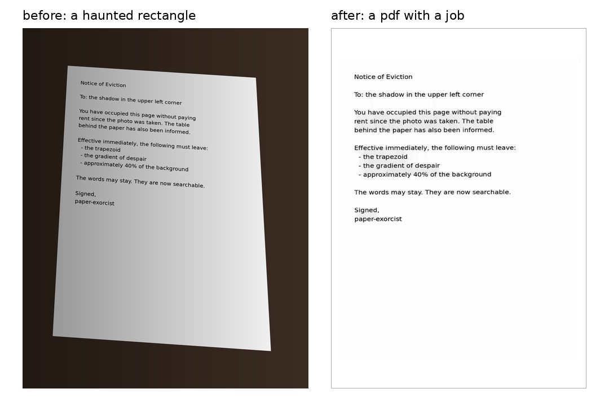

# paper-exorcist

i wanted a pdf. my phone offered a haunted rectangle.

so i put python inside a bash script and told the shadows to find a job.
it crops document photos, corrects perspective, reduces shadows, and turns images or zip archives into one pdf. now the words can leave the rectangle too: ocr adds searchable, selectable text.



made this for myself. use it if you want ([mit](LICENSE)). bring your own coffee.

## summon it (ubuntu 22.04)

```bash
sudo apt update
sudo apt install python3 python3-opencv python3-pil python3-reportlab
sudo apt install tesseract-ocr tesseract-ocr-tur tesseract-ocr-eng fonts-dejavu-core
sudo apt install libheif-examples   # optional: iphone heic photos

git clone https://github.com/bitkicayi/paper-exorcist.git
cd paper-exorcist
make install
```

`make install` puts it in `~/.local/bin`. if your terminal still forgets the command, add `$HOME/.local/bin` to its `PATH`.
`make uninstall` sends it back. you can also skip installation and run `bash paper-exorcist.sh` with the same options.

## feed it rectangles

```bash
# one photo, one pdf
paper-exorcist -o document.pdf photo.png

# phone photos with shadow-related emotional baggage
paper-exorcist --mode scan -o document.pdf photos.zip

# straight from an iphone, heic and all
paper-exorcist --mode scan -o receipts.pdf IMG_4021.HEIC IMG_4022.HEIC

# photographed sideways because the table was in the way
paper-exorcist --rotate auto -o document.pdf sideways.jpg

# english text, searchable and selectable (ocr is on by default)
paper-exorcist --ocr-lang eng --mode scan -o searchable.pdf photos.zip

# turkish books deserve their own dictionary
paper-exorcist --ocr-lang tur -o book.pdf page.png

# labels scattered around a diagram
paper-exorcist --ocr-psm 11 -o diagram.pdf diagram.png

# sometimes a rectangle just wants to remain a rectangle
paper-exorcist --no-ocr -o image-only.pdf photo.png

# several offerings, one pdf, in the order you give them
paper-exorcist -o combined.pdf page1.png page2.jpg archive.zip

# a folder, including its basement
paper-exorcist --recursive --mode scan -o document.pdf ./photos

# 300 photos, one of them cursed: skip it, keep the rest
paper-exorcist --keep-going -o semester.pdf lectures.zip

# already cropped? let the corners rest
paper-exorcist --no-auto-crop -o document.pdf scans.zip

# manual eviction: x,y,width,height in pixels
paper-exorcist --crop 120,80,1000,1400 -o document.pdf photo.png

# the remaining knobs
paper-exorcist --help
```

png, jpeg, webp, bmp, heic and single-page tiff work. zip subfolders are included automatically.
folder and archive contents use natural filename order. one image becomes one pdf page.
pages are processed in parallel, up to four at a time. `--jobs 1` for a quiet laptop, `--jobs 8` if you have cores to burn.

`--mode scan` reduces shadows and produces grayscale. the default keeps colors.
existing output? add `--force`. failed detection keeps the full image; `--strict` stops instead.

the script speaks turkish. the paper doesn't mind.

## ocr

ocr runs locally with [tesseract](https://tesseract-ocr.github.io/tessdoc/Command-Line-Usage.html). the default languages are `tur+eng`; for a single-language document, choose `--ocr-lang tur` or `--ocr-lang eng`. other languages need their tesseract language pack. `tesseract --list-langs` lists installed languages.
ocr follows cropping and rotation. it cleans shadows in its own working copy by default, even when the pdf keeps its original colors. use `--mode scan` to clean the visible page too, or `--ocr-preprocess none` if the cleanup makes your particular image worse.
invisible, selectable text follows the recognized lines so copying a sentence does not turn it into word soup. `--no-ocr` skips recognition and does not require tesseract.
`--ocr-psm 3` handles page layout automatically; try `6` for one text block or `11` for scattered labels. slow page? raise `--ocr-timeout 120`.

## when the exorcism fails

**the crop ate half the page.** the rectangle had ambitions. run with `--debug-dir debug/` and look at `debug/0001-*-detect.jpg`: green is what it believed was paper. the log also prints a `--crop` suggestion you can adjust and reuse.

**the page came out sideways.** add `--rotate auto`. pages with very little text keep their orientation, because guessing is how hauntings start. `--rotate 90` when you know better.

**ocr wrote "Satir" instead of "Satır".** tesseract is still learning turkish. aren't we all. use `--ocr-lang tur` for turkish-only pages; blur, handwriting and tiny text stay hard.

**iphone photo refused.** it's heic. `sudo apt install libheif-examples` and try again. portrait-mode depth maps are ignored; they were never part of the document.

**one bad photo killed the whole zip.** `--keep-going` skips it, finishes the pdf and exits with `2` so scripts can tell.

**it's slow.** ocr is most of the time. `--jobs` uses more cores, `--no-ocr` skips the reading entirely.

this is still a coffee-powered script, not a resurrection service.

## poking the machine

```bash
make test   # fakes phone photos, runs the real script, reads the pdf back
make lint   # shellcheck + pyflakes on the python hiding in the heredoc
make demo   # redraws docs/demo.jpg
```

tests need `poppler-utils`; lint needs `shellcheck` and `python3-pyflakes`. ci does all of it on ubuntu 22.04.
history lives in [CHANGELOG.md](CHANGELOG.md).
